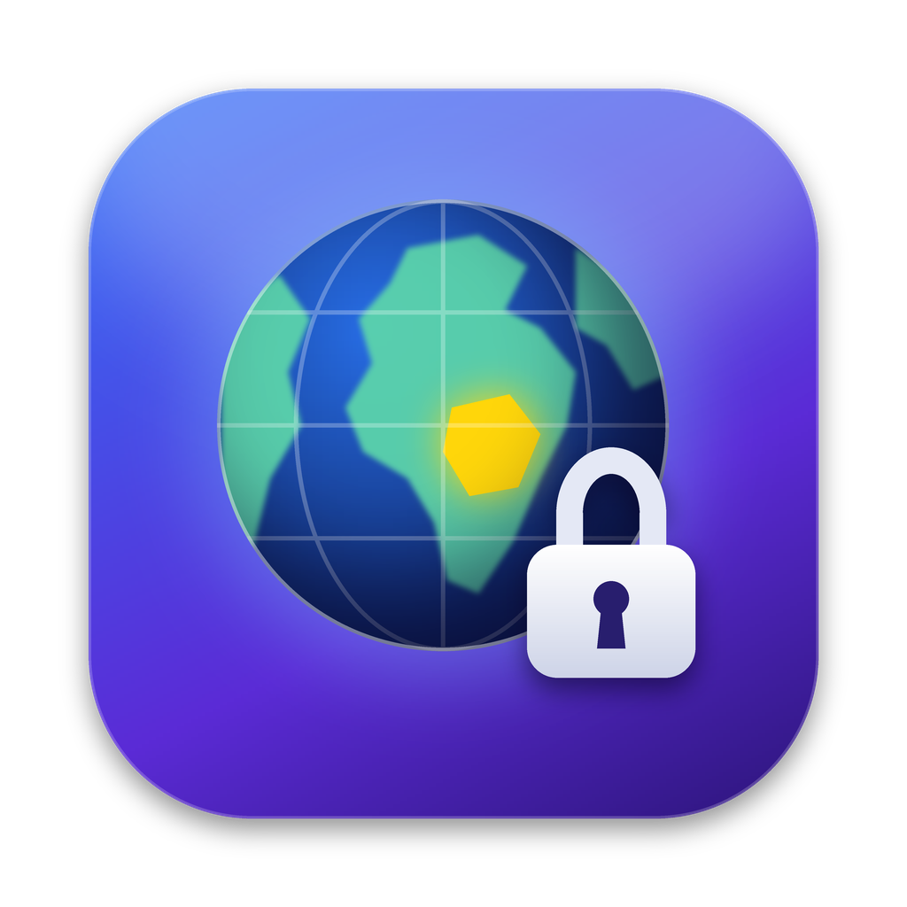
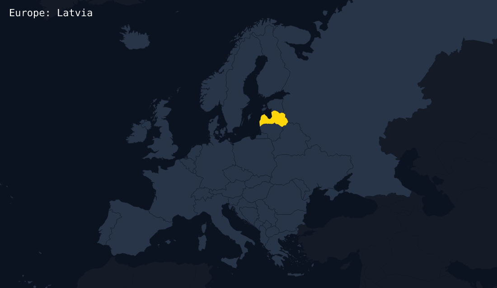
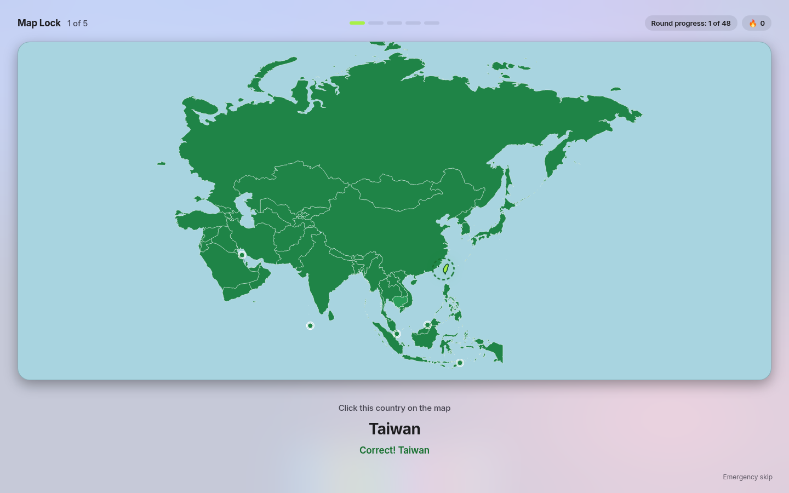
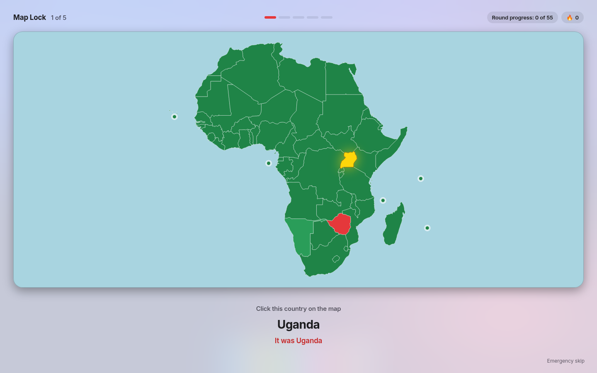
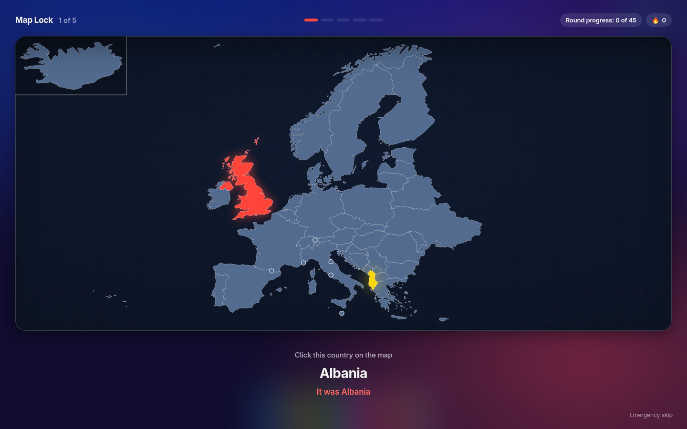

<p align="center"></p>

<h1 align="center">Map Lock</h1>

<p align="center">A small Mac app that makes you name a few countries before you get back to work.</p>

<p align="center"><a href="https://github.com/oiwdis/map-lock/releases/latest"><b>Download for Mac</b></a> &nbsp;·&nbsp; <a href="https://map-lock.elliot-7c9.workers.dev">Try it in your browser</a></p>



## What it is

Map Lock covers your screen with a map. One country lights up and you name it. A few questions
(you choose how many), then you are back to your Mac. It can quiz you every time you unlock your Mac,
when it wakes from sleep, at set times each day, or at a random time each day. You can also run a
full continent or whole-world practice test any time without locking the screen. It lives in your
Dock and in the menu bar (the globe icon).

| | |
|---|---|
|  |  |
| Asia, click the country. Small countries have a dot. | Africa, click the country. Wrong in red, the right one in yellow. |



Dark mode is there too, or let it match your Mac.

## Download

1. Get `MapLock.zip` from the [latest release](https://github.com/oiwdis/map-lock/releases/latest).
2. Double click it to unzip, then drag **Map Lock** into your Applications folder.
3. Open it. The app is signed and notarized by Apple, so it opens like any other app.

When you first open it, Map Lock offers to move itself to your Applications folder.

### Requirements

- macOS 14 (Sonoma) or newer
- An Apple silicon Mac (M1 or newer). On an Intel Mac, build from source below.

## How it works

- When a quiz starts, Map Lock fills the screen until you finish the questions.
- Multiple choice or type the name. Every country in your regions comes up once before repeats,
  and ones you miss come back soon.
- Need out right now? Use the small **Emergency skip** button in the corner. The day just does not count for your streak.

## Using it

Click the Map Lock icon in the Dock to open the home window. There you can:

- **Quiz me now**: start a short unlock-style quiz any time.
- The home window uses a macOS **sidebar**: **Practice**, **Race**, **Stats**, **Account**, and **Settings**.
- **Practice**: choose a destination, subject and answer method, then your pace (10 / 20 / 50 / All,
  or Speedrun). The session summary and **Start practice** stay visible as you scroll. Press **⌘Return**
  to start. Practice opens in a normal window and never locks your screen.
- **Stats**: best score, best time, streak, and most-missed countries (this Mac only).
- **Settings** groups controls into **Quizzes**, **App & appearance**, and **Your data**. Changes save
  automatically. Quizzes contains unlock/wake schedules, question count, subject, answer method, and regions;
  App & appearance contains theme, sounds, notifications, and login options; Your data contains stats reset.
- **Unlock quiz** in the toolbar starts a screen-locking quiz using your unlock settings. The menu bar still calls this **Quiz me now**.
- See your day streak and how far you are through the current round.
- **Quiz type**: **Name the country**, **Click the country**, or **Mix**.
- **Ask about**: **Countries** (default), **Capitals**, or **Flags** (emoji flags, offline). Capitals and
  Flags stay off until you pick them.
- **Appearance**: **Light** (default), **Dark**, or **Match system**.
- **Answer style** (for Name the country): Multiple choice, Type the name, or a mix of both.
  Type the name accepts common alternate spellings, case and accents ignored.
- **Unlock quiz**: how many questions (5, 10, 20, or All), and an optional **Require 100% to unlock**
  mode that re-asks misses until they are right (with a 10-minute safety time limit).
- **Regions**: Africa, Asia, Europe, North America, South America. Africa and Asia are on at first.
- **When to quiz**: Every unlock, optional also on wake from sleep, and the schedule below.
- **Open at login**: start Map Lock by itself when you log in.
- **Hide Map Lock**: closes the window. Map Lock keeps running so quizzes still show.

The globe icon in the menu bar has the same choices.

### When to quiz

- **Every unlock**: a quiz shows each time you unlock your Mac. This is on at first. It works on its own,
  so you can use it together with a schedule.
- **Also on wake from sleep**: optional. Quizzes when the Mac wakes even if no password unlock follows.
  Off at first.
- **At a set time**: pick one or more times each day (4:00 PM at first). Use **Add a time** for more.
- **Random time each day**: pick a window (3:00 PM to 9:00 PM at first). Map Lock picks one time in that
  window each day and keeps it, even if you restart. The home window shows "Today's quiz: around 6:42 PM".
  Turn on **Keep it a surprise** to see only "sometime between 3:00 PM and 9:00 PM".
- **No set time**: only the unlock quiz (if it is on) and Quiz me now.

Good to know about the schedule:

- If your Mac is asleep or locked at the quiz time, the quiz shows when you wake or unlock it later that same day.
  A missed time does not carry over to the next day.
- Each time fires at most once a day. If you add a time that already passed today, it starts tomorrow.
- If a quiz is already on screen, a second one does not pop up.
- Map Lock has to be running for this to work. Turn on **Open at login** so it always is.

### Open at login

Turn it on in the home window or the menu. If macOS asks for approval, open
**System Settings > General > Login Items** and turn Map Lock on there. The home window has a button
that takes you there.

### The quiz

- Multiple choice: click an answer or press 1, 2, 3 or 4.
- Typing: type the name and press Return. Case and accents do not matter, common other names work
  (for example "Ivory Coast", "Burma", "DRC", "W. Sahara"), and small typos are OK.
- Click the country: the whole region is shown. Click the country that is named. Right turns it green
  and the next question comes by itself. Wrong flashes the country you clicked in red and shows the
  right one in yellow (small ones also get a ring); it counts as a miss and comes back later. A click in the sea does nothing.
  Very small islands and microstates have a dot you can click (for example the Maldives, Singapore,
  Malta or Seychelles). Other small countries are clicked by their shape, and a click just outside
  the edge still counts.
- Press Return for the next question.
- Every country in your regions comes up once before any repeats. That is one round.
  A missed country comes back a few questions later until you get it right.
- If you really need to get out, use the small **Emergency skip** in the bottom right corner.
  Skipping means the day does not count for your streak.

Motion follows your Mac's **Reduce motion** setting (System Settings > Accessibility > Display).

## Quit

Quitting only hides Map Lock. Command Q, Quit in the Dock menu, and **Hide Map Lock** in the home window
or the globe menu all close the window, and Map Lock keeps running so your quizzes still show,
also after your Mac wakes up. Click the Dock icon to open it again.

To really stop it, use Force Quit (Option Command Escape, or the Apple menu > Force Quit), pick
Map Lock, and click Force Quit. Log out, restart and shut down still work as normal.

## Update or remove

- To update: download the newest `MapLock.zip` and replace the app in Applications.
- To remove: turn off Open at login, Force Quit Map Lock, then drag Map Lock from Applications to the Trash.

The [UI redesign notes](docs/UI-REDESIGN.md) describe the native design choices, automated checks,
and manual release checks.

## Build from source

You need macOS 14 or newer and the Command Line Tools (`xcode-select --install`). No Xcode needed.

```
git clone https://github.com/oiwdis/map-lock.git
cd map-lock
./build-app.sh
```

This builds **Map Lock.app**, signs it just for your Mac, and installs it in Applications
(or `~/Applications`). To try it without making the app, run `swift run`
(Open at login only works in the real app).

The app icon is `Resources/AppIcon.png`. To make a signed and notarized release, see [RELEASING.md](RELEASING.md).

## Good to know

- This is a study tool, not real security. It does not protect your Mac, and Emergency skip always works.
- Each map shows only the countries of the region you are studying. Land from other regions is
  left out and looks like sea.
- North America has 16 countries. The small island countries of the eastern Caribbean (Antigua and
  Barbuda, Barbados, Dominica, Grenada, Saint Kitts and Nevis, Saint Lucia, Saint Vincent and the
  Grenadines) are not in the app.
- Map data: Natural Earth (public domain), simplified to keep the app small.

## License

MIT. See [LICENSE](LICENSE).
